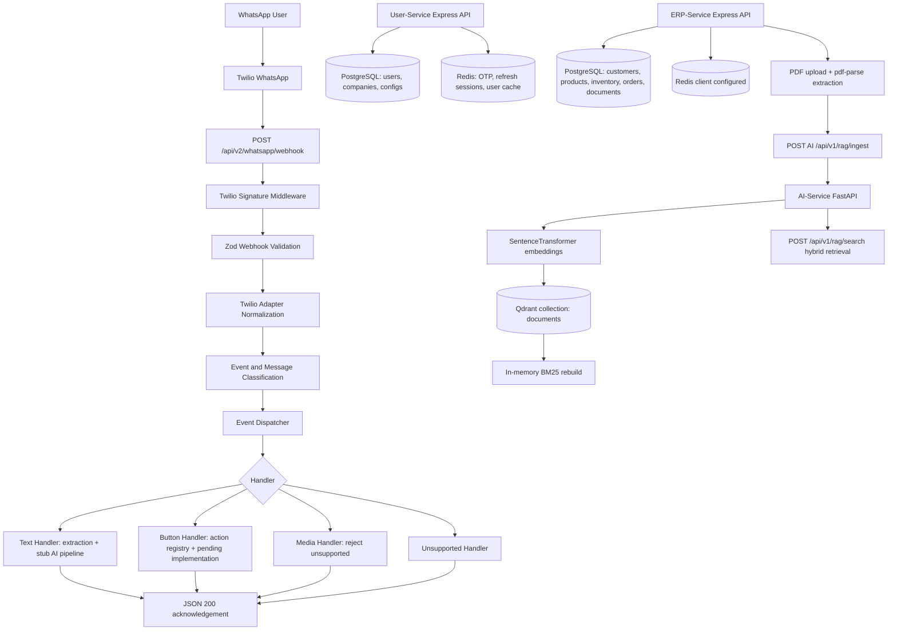

# DistroSync Project Status Audit

Audit date: 2026-08-31

Scope: read-only audit of the current repository, including source code, config examples, Prisma schemas/migrations, tests, docs, and recent git history. Actual secret values are not copied here.

## 1. Project Overview

This repository contains a multi-service backend for a WhatsApp-driven business assistant called DistroSync. The implemented pieces suggest the intended product is a WhatsApp interface for business users/customers that can receive WhatsApp messages, connect tenant/company configuration, manage ERP-style customer/product/order data, ingest business PDFs into a RAG index, and eventually use AI to interpret messages and take business actions.

Current architecture:

- `whatsapp-service`: Express service for Twilio WhatsApp webhook ingestion. It validates Twilio signatures, validates webhook payloads with Zod, normalizes Twilio form data into canonical events, classifies message/event types, dispatches to handlers, and returns JSON acknowledgements.
- `user-service`: Express service for user registration/login, JWT cookies, OTP-backed signup, company creation, and storage of WhatsApp/ERP connection configuration.
- `ERP-service`: Express service for tenant-scoped business data: customers, products, inventory, orders, PDF documents, and AI RAG ingestion handoff.
- `AI-service`: FastAPI service with implemented RAG ingestion/search over Qdrant plus BM25 hybrid retrieval. LLM/chat orchestration modules are present but currently stubs.

Main technologies:

- Node.js, Express, CommonJS
- FastAPI/Python 3.12
- Prisma ORM
- PostgreSQL
- Redis/ioredis
- Twilio Node SDK
- Zod validation
- JWT auth with `jsonwebtoken`
- bcrypt password hashing
- Multer and `pdf-parse` for ERP document uploads
- `pypdf`, `sentence-transformers`, Qdrant, and `rank-bm25` in AI-service
- Dockerfiles/docker-compose files for individual services
- Jest tests in `whatsapp-service` and `ERP-service`

Current status:

- WhatsApp inbound webhook pipeline: IMPLEMENTED for Twilio validation, payload validation, normalization, classification, and handler dispatch.
- WhatsApp outbound message provider: PARTIALLY IMPLEMENTED as a provider/service function, but not wired into the current webhook handlers.
- Text message AI processing: PARTIALLY IMPLEMENTED as a scaffold; intent/entity/action/response functions are explicit stubs.
- User auth/company/config service: PARTIALLY IMPLEMENTED. Core auth/config flows exist, but at least one current export bug affects `GET /auth/me`.
- ERP customer/product/order/document APIs: IMPLEMENTED at service/API level.
- AI RAG ingestion/search: IMPLEMENTED at endpoint level.
- AI conversational LLM/orchestration: NOT IMPLEMENTED. Stub files exist.
- Conversation memory tied to WhatsApp users: NOT IMPLEMENTED.

## 2. Repository Structure

Important structure:

```text
.
  docker-compose.yml
  whatsapp-service/
    index.js
    src/app.js
    src/config/
    src/modules/whatsapp/
      presentation/routes/webhook.routes.js
      presentation/controllers/webhook.controller.js
      presentation/middleware/twilioSignature.middleware.js
      presentation/middleware/errorHandler.middleware.js
      validation/webhook.schema.js
      validation/webhook.validator.js
      infrastructure/providers/twilio/
      domain/classification/
      domain/models/canonical-event.js
      domain/errors/webhook.errors.js
      application/events/
      application/handlers/
    prisma/schema.prisma
    tests/
    POSTMAN_TESTING.md
  user-service/
    index.js
    src/app.js
    src/routes/
    src/controllers/
    src/services/
    src/utils/
    src/middlewares/
    src/config/
    prisma/schema.prisma
  ERP-service/
    index.js
    src/app.js
    src/modules/
      customers/
      products/
      inventory/
      orders/
      documents/
    src/shared/
    src/config/
    prisma/schema.prisma
    tests/
  AI-service/
    app/main.py
    app/core/config.py
    app/rag/vector_store.py
    app/intelligence/embeddings/embedding_service.py
    app/api/schemas/
    app/api/routes/health.py
    app/intelligence/llm/
    app/intelligence/extraction/
    app/orchestration/
    app/tools/
```

Important files and purposes:

- `docker-compose.yml`: root compose file exists but is empty. PARTIALLY IMPLEMENTED / NOT USEFUL AS CURRENTLY WRITTEN.
- `whatsapp-service/index.js`: loads `.env`, starts Express on `PORT`, logs service status, and handles SIGTERM/SIGINT shutdown.
- `whatsapp-service/src/app.js`: creates the Express app, enables `trust proxy`, installs URL-encoded parsing, JSON parsing, cookies, Helmet, and mounts `/api/v2/whatsapp/webhook`.
- `whatsapp-service/src/modules/whatsapp/presentation/routes/webhook.routes.js`: defines the single current Twilio webhook route, `POST /`, with URL-encoded parsing, signature middleware, controller, and centralized webhook error handler.
- `webhook.controller.js`: orchestrates validation, normalization, event classification, message classification, dispatch, handler execution, logging, and response.
- `twilioSignature.middleware.js`: validates `X-Twilio-Signature` using Twilio's `validateRequest` and `TWILIO_AUTH_TOKEN`.
- `webhook.schema.js` / `webhook.validator.js`: define and run Zod validation for text, media, status, location, contact, and interactive Twilio webhook payloads.
- `twilio.adapter.js`: normalizes Twilio form fields into the canonical event model and extracts media arrays.
- `twilio.provider.js`: initializes Twilio SDK client, sends outbound WhatsApp messages, parses incoming payloads, and creates TwiML responses. Present but not used by current webhook handler.
- `canonical-event.js`: provider-independent event structure.
- `event.classifier.js` / `message.classifier.js`: classify inbound payloads into top-level event types and message types.
- `event.registry.js` / `event.dispatcher.js`: map event/message types to event names and handlers.
- `text.handler.js`: extracts text and builds context, but AI intent/entity/action/response steps are explicit stubs.
- `button.handler.js` / `button.registry.js`: resolves supported button/list actions and returns pending implementation results.
- `media.handler.js`: rejects media processing with structured `MEDIA_NOT_SUPPORTED`.
- `unsupported.handler.js`: rejects status/unknown/unregistered events.
- `webhook.errors.js`: custom error hierarchy for auth, validation, normalization, and classification failures.
- `whatsapp-service/prisma/schema.prisma`: contains user/company/config models duplicated from user-service. No current WhatsApp webhook persistence code uses it.
- `whatsapp-service/POSTMAN_TESTING.md`: documents expected Twilio webhook testing. It mentions a legacy `/api/whatsapp/webhook`, but the current app only mounts `/api/v2/whatsapp/webhook`.
- `user-service/src/app.js`: Express app mounting `/auth`, `/companies`, `/erp`, and `/whatsapp`.
- `user-service/src/controllers/*.js`: HTTP layer for auth, company, ERP config, and WhatsApp config.
- `user-service/src/services/*.js`: Prisma/Redis business logic for signup/login/session/config management.
- `user-service/src/utils/otp.js`: OTP generation, HMAC hashing, Redis storage, rate limiting, and attempt limiting.
- `user-service/src/utils/auth.js`: JWT access/refresh token generation and verification.
- `user-service/src/utils/device.js`: request fingerprint hashing for refresh-session device IDs.
- `user-service/src/middlewares/auth.middleware.js`: verifies JWT from cookie or Bearer token and loads user from Prisma.
- `user-service/prisma/schema.prisma`: PostgreSQL schema for users, companies, WhatsApp configs, and ERP configs.
- `ERP-service/src/app.js`: Express app with CORS, JSON/urlencoded parsing, cookies, Helmet, `/health`, and `/api/v1/*` module routes.
- `ERP-service/src/shared/middleware/auth.middleware.js`: supports JWT auth or internal `x-service-key` plus `x-tenant-id`.
- `ERP-service/src/modules/customers`: tenant-scoped customer create/list/get APIs.
- `ERP-service/src/modules/products`: tenant-scoped product create/list/search/get APIs, including initial inventory creation.
- `ERP-service/src/modules/inventory`: repository/service helpers for stock lookup and atomic reservation.
- `ERP-service/src/modules/orders`: tenant-scoped order create/list/get/status update APIs; creates orders and reserves inventory in transactions.
- `ERP-service/src/modules/documents`: PDF upload/list/get/ingest APIs; extracts text and sends it to AI-service.
- `ERP-service/src/modules/documents/ai-rag.client.js`: calls AI-service `POST /api/v1/rag/ingest`.
- `ERP-service/prisma/schema.prisma`: ERP business schema for customers, products, inventory, orders, order items, and documents.
- `AI-service/app/main.py`: FastAPI app with `/health`, `/api/v1/rag/upload`, `/api/v1/rag/search`, and `/api/v1/rag/ingest`.
- `AI-service/app/core/config.py`: Pydantic settings for Qdrant, embeddings, chunking, retrieval weights, and top-k.
- `AI-service/app/rag/vector_store.py`: Qdrant-backed vector store plus in-memory BM25 rebuild/search.
- `AI-service/app/intelligence/embeddings/embedding_service.py`: SentenceTransformer embedding wrapper.
- `AI-service/app/intelligence/llm/*`, `app/orchestration/*`, `app/clients/*`, `app/tools/*`, `app/observability/*`: present but contain only `# Stub - not yet implemented.`

## 3. Complete Request Flow

Implemented WhatsApp inbound flow:

```text
WhatsApp user
  -> Twilio WhatsApp webhook
  -> public tunnel/webhook URL configured in Twilio
  -> whatsapp-service Express app
  -> POST /api/v2/whatsapp/webhook
  -> express.urlencoded parser
  -> Twilio signature middleware
  -> webhook controller
  -> Zod payload validation
  -> Twilio payload normalization
  -> event type classification
  -> message type classification
  -> event dispatch
  -> handler execution
  -> JSON acknowledgement response
```

Endpoint:

- Method: `POST`
- Path: `/api/v2/whatsapp/webhook`
- Content type expected: `application/x-www-form-urlencoded`
- Important header: `X-Twilio-Signature`
- Auth/validation: `twilioSignatureMiddleware` validates the Twilio signature before controller logic.
- Controller: `handleWebhook(req, res, next)`
- Validation function: `validate(req.body)`
- Normalization function: `normalize(validationResult.data)`
- Classifiers: `classifyEventType(canonicalEvent)`, `classifyMessageType(canonicalEvent)`
- Dispatcher: `dispatch(canonicalEvent)` then `handle(dispatchResult)`
- Success response: HTTP 200 JSON with `success: true`, the resolved event, and handler result.
- Error response: `webhookErrorHandler` returns structured JSON for known `WebhookError` instances, otherwise 500 generic error.

What is not in the current WhatsApp request flow:

- No database user lookup/creation from WhatsApp sender.
- No message/conversation persistence.
- No call to AI-service.
- No call to ERP-service.
- No Twilio outbound reply in the webhook handler.
- No GET verification endpoint for Twilio. Twilio WhatsApp webhooks do not require Meta-style GET verification.

Implemented ERP document-to-RAG flow:

```text
Authenticated caller
  -> ERP-service POST /api/v1/documents
  -> Multer PDF upload
  -> Document row created as UPLOADED
  -> POST /api/v1/documents/:id/ingest
  -> pdf-parse extracts text
  -> ERP-service calls AI-service POST /api/v1/rag/ingest
  -> AI-service chunks text
  -> SentenceTransformer embeddings
  -> Qdrant upsert
  -> BM25 index rebuild
  -> ERP Document updated to INGESTED with aiDocumentId
```

Implemented AI RAG search flow:

```text
Caller
  -> AI-service POST /api/v1/rag/search
  -> embed query
  -> dense Qdrant query
  -> sparse BM25 scoring
  -> weighted score merge
  -> top-k ranked chunks returned
```

## 4. WhatsApp/Twilio Integration

Twilio integration status: PARTIALLY IMPLEMENTED.

Implemented:

- Twilio SDK dependency exists in `whatsapp-service`.
- Incoming Twilio webhook route exists.
- `X-Twilio-Signature` validation exists.
- Incoming Twilio form fields are validated and normalized.
- `twilio.provider.js` can initialize a Twilio client and call `client.messages.create()` for outbound WhatsApp messages.
- TwiML response generation exists via `MessagingResponse`.
- Actual local `.env` exists under `whatsapp-service` with Twilio variable names.

<<<<<<< HEAD
Not wired in current webhook flow:

- No handler calls `whatsapp.service.sendMessage`.
=======
Current webhook flow:

- The text handler calls `whatsapp.service.sendMessage` for AI-generated replies.
>>>>>>> 3f3efc8a9fab2c1e789bd1ced6ea2c7e8f7e58a3
- No handler returns TwiML XML to Twilio; the controller returns JSON.
- No persistence of Twilio message SID, sender, recipient, or body.

WhatsApp sender/test number:

- `.env.example` uses `TWILIO_WHATSAPP_NUMBER=whatsapp:+14155238886`, Twilio's common sandbox sender example.
- Actual value in `whatsapp-service/.env` is not copied here.

Incoming webhook:

- Current path: `/api/v2/whatsapp/webhook`
- Method: `POST`
- Body: URL-encoded Twilio payload.
- Required signature header: `X-Twilio-Signature`.
- `TWILIO_WEBHOOK_URL` can override URL reconstruction for signature verification.

Outgoing message API:

<<<<<<< HEAD
- Function: `sendMessage(to, body, options = {})` in `twilio.provider.js`.
- Supports plain `body`.
- Supports Twilio Content API templates via `options.contentSid` and optional `contentVariables`.
=======
- Function: `sendMessage(to, body)` in `twilio.provider.js`.
- The conversational reply path sends plain text using `body`.
- Content API template fields are not used by the current WhatsApp chatbot flow.
>>>>>>> 3f3efc8a9fab2c1e789bd1ced6ea2c7e8f7e58a3
- Formats both sender and recipient with `whatsapp:` prefix.

Environment variables used by Twilio code:

- `TWILIO_ACCOUNT_SID=[REDACTED]`
- `TWILIO_AUTH_TOKEN=[REDACTED]`
- `TWILIO_WHATSAPP_NUMBER=[REDACTED]`
- `TWILIO_WEBHOOK_URL=[REDACTED]`
- `PORT`
- `SERVICE_NAME`
- `NODE_ENV`

Message fields received:

- Required for text: `MessageSid`, `AccountSid`, `From`, `To`, `Body`
- Required for media: `MessageSid`, `AccountSid`, `From`, `To`, `NumMedia`, `MediaContentType0`, `MediaUrl0`
- Status callbacks: `MessageSid`, `AccountSid`, `MessageStatus`
- Optional/common: `ProfileName`, `WaId`, `NumSegments`, `SmsMessageSid`, `SmsSid`, `SmsStatus`, `ApiVersion`, `MessageType`
- Location: `Latitude`, `Longitude`
- Contact: `vCard`
- Interactive: `ButtonText`, `ListId`

Current limitations:

- Webhook processes and acknowledges events but does not send a WhatsApp reply.
- Text AI/NLP stages are stubs.
- Media handler rejects all media.
- Button actions resolve but return `pending_implementation`.
- No Meta Cloud API production webhook is implemented in current mounted app, despite Meta env examples.
- `POSTMAN_TESTING.md` mentions legacy `/api/whatsapp/webhook`, but current code does not mount it.

## 5. Webhook Implementation

GET verification endpoint: NOT IMPLEMENTED.

POST webhook endpoint:

- Mounted in `whatsapp-service/src/app.js` at `/api/v2/whatsapp/webhook`.
- Route file defines `router.post('/')`, so full path is `/api/v2/whatsapp/webhook`.
- Middleware order: URL-encoded parser, Twilio signature middleware, `handleWebhook`.

Signature validation:

- Header: `x-twilio-signature`.
- Missing header: `AuthenticationError` with status 401.
- Placeholder/missing `TWILIO_AUTH_TOKEN`: status 500 configuration error.
- Invalid signature: `AuthenticationError` with status 403.
- URL selection:
  - If `TWILIO_WEBHOOK_URL` is set and does not contain `your-ngrok-url`, use it.
  - Otherwise build from forwarded protocol/host and `req.originalUrl`.

Validation succeeds:

1. Body is validated using schema selected by `detectWebhookType`.
2. Twilio fields are normalized into a canonical event.
3. Event type and message type are assigned.
4. Dispatcher resolves event string.
5. Registered handler runs.
6. Controller logs `[Webhook] <event> -> <status> from <phone-or-unknown>`.
7. HTTP 200 JSON is returned.

Validation fails:

- Schema validation failures become `ValidationError` with HTTP 400 and field-level details.
- Known webhook errors are serialized via `err.toJSON()`.
- Unknown errors are logged internally and returned as generic HTTP 500.

Extraction details:

- Message body: `validatedPayload.Body?.trim()` into `canonicalEvent.content.text`.
- Sender: `From` normalized by stripping `whatsapp:` and ensuring `+`.
- Recipient: `To` normalized the same way.
- Message SID: `MessageSid` becomes `canonicalEvent.id`.
- Account SID: stored in `canonicalEvent.metadata.accountSid`.
- Raw Twilio payload: stored in `canonicalEvent.metadata.raw`.
- Media: `MediaUrl0`, `MediaContentType0`, etc. become `content.media[]`.

Current logging:

- Webhook success log includes event, handler status, and sender phone.
- Signature failures log evaluated URL, received signature, and auth token length. This avoids printing the token, but printing the received signature is still sensitive enough to treat carefully.
- Twilio provider logs send success/failure.

## 6. API Documentation

| Method | Endpoint | Purpose | Authentication | Request | Response | Status |
|---|---|---|---|---|---|---|
| POST | `/api/v2/whatsapp/webhook` | Ingest Twilio WhatsApp webhook | Twilio signature | URL-encoded Twilio form fields | JSON handler result | IMPLEMENTED |
| POST | `/auth/send-otp` | Start signup OTP | None | JSON `{name,email,phone?,password}` | Sets `otpSessionId` cookie | IMPLEMENTED |
| POST | `/auth/verify-otp` | Verify signup OTP and create user | `otpSessionId` cookie | JSON `{otp}` | Created user without passwordHash | IMPLEMENTED |
| POST | `/auth/login` | Login user | None | JSON `{email,password}` | Sets `accessToken`, `refreshToken` cookies | IMPLEMENTED |
| POST | `/auth/refresh` | Refresh tokens | `refreshToken` cookie | No body required | New token cookies and user | IMPLEMENTED |
| POST | `/auth/logout` | Logout current device | JWT cookie/Bearer | No body required | Success message | IMPLEMENTED |
| GET | `/auth/me` | Return current user | JWT cookie/Bearer | None | User | PARTIALLY IMPLEMENTED: controller calls unexported service function |
| POST | `/companies` | Create company and link current user | JWT | JSON company data | Company | IMPLEMENTED |
| GET | `/companies/:companyId` | Get user's company | JWT | Path UUID-ish string, not actually used by service | Company | IMPLEMENTED with ignored path `companyId` |
| PATCH | `/companies/:companyId` | Update user's company | JWT | JSON partial company data | Company | IMPLEMENTED with ignored path `companyId` |
| DELETE | `/companies/:companyId` | Delete user's company | JWT | Path `companyId`, not used by service | Success message | IMPLEMENTED with ignored path `companyId` |
| POST | `/erp` | Create ERP config for user's company | JWT | JSON `{erpType,pluginName,connectionConfig}` | ERP config | IMPLEMENTED |
| GET | `/erp` | Get ERP config | JWT | None | ERP config | IMPLEMENTED |
| PATCH | `/erp` | Update ERP config | JWT | JSON partial config | ERP config | IMPLEMENTED |
| DELETE | `/erp` | Delete ERP config | JWT | None | Success message | IMPLEMENTED |
| POST | `/whatsapp` | Create WhatsApp config | JWT | JSON config with access token/secret fields | WhatsApp config | IMPLEMENTED |
| GET | `/whatsapp` | Get WhatsApp config | JWT | None | WhatsApp config | IMPLEMENTED |
| PATCH | `/whatsapp` | Update WhatsApp config | JWT | JSON partial config | WhatsApp config | IMPLEMENTED |
| DELETE | `/whatsapp` | Delete WhatsApp config | JWT | None | Success message | IMPLEMENTED |
| GET | `/health` | ERP service health | None | None | Service health JSON | IMPLEMENTED |
| POST | `/api/v1/customers` | Create customer | JWT or service key + tenant | JSON `{name,phone,externalId?}` | Customer | IMPLEMENTED |
| GET | `/api/v1/customers` | List customers | JWT or service key + tenant | Query `skip`, `take` | Customer list | IMPLEMENTED |
| GET | `/api/v1/customers/by-phone/:phone` | Get customer by phone | JWT or service key + tenant | Path phone | Customer | IMPLEMENTED |
| GET | `/api/v1/customers/:id` | Get customer by ID | JWT or service key + tenant | UUID path | Customer | IMPLEMENTED |
| POST | `/api/v1/products` | Create product with inventory | JWT or service key + tenant | JSON product payload | Product | IMPLEMENTED |
| GET | `/api/v1/products` | List products | JWT or service key + tenant | Query `skip`, `take`, `onlyActive` | Product list | IMPLEMENTED |
| GET | `/api/v1/products/search` | Search products | JWT or service key + tenant | Query `q`, `limit` | Product list | IMPLEMENTED |
| GET | `/api/v1/products/:id` | Get product by ID | JWT or service key + tenant | UUID path | Product | IMPLEMENTED |
| POST | `/api/v1/orders` | Create order and reserve inventory | JWT or service key + tenant | JSON `{customerId,items[]}` | Order | IMPLEMENTED |
| GET | `/api/v1/orders` | List orders | JWT or service key + tenant | Query `skip`, `take`, `customerId?` | Order list | IMPLEMENTED |
| GET | `/api/v1/orders/:id/status` | Get order status | JWT or service key + tenant | UUID path | Status object | IMPLEMENTED |
| GET | `/api/v1/orders/:id` | Get order by ID | JWT or service key + tenant | UUID path | Order | IMPLEMENTED |
| PATCH | `/api/v1/orders/:id/status` | Update order status | JWT or service key + tenant | JSON `{status}` | Status object | IMPLEMENTED |
| POST | `/api/v1/documents` | Upload PDF document | JWT or service key + tenant | multipart field `file` | Document metadata | IMPLEMENTED |
| GET | `/api/v1/documents` | List documents | JWT or service key + tenant | Query `skip`, `take` | Document list | IMPLEMENTED |
| POST | `/api/v1/documents/:id/ingest` | Extract text and ingest into AI RAG | JWT or service key + tenant | UUID path | Document metadata | IMPLEMENTED |
| GET | `/api/v1/documents/:id` | Get document by ID | JWT or service key + tenant | UUID path | Document metadata | IMPLEMENTED |
| GET | `/health` | AI service health | None | None | `{"status":"ok"}` | IMPLEMENTED |
| POST | `/api/v1/rag/upload` | Upload PDF directly to AI RAG | None | multipart PDF `file` | Upload/chunk count | IMPLEMENTED |
| POST | `/api/v1/rag/ingest` | Ingest pre-extracted text | None | JSON `IngestRequest` | Upload/chunk count | IMPLEMENTED |
| POST | `/api/v1/rag/search` | Hybrid dense/BM25 search | None | JSON `{query,top_k}` | Ranked chunks | IMPLEMENTED |

Endpoint detail notes:

- User-service endpoints do not use a centralized error handler; controllers catch and return HTTP 500 for most business validation failures.
- ERP-service endpoints use centralized `AppError`, Zod, Multer, JSON parse, and generic error handling.
- AI-service endpoints raise FastAPI `HTTPException` for validation/extraction errors but do not implement auth.
- WhatsApp-service endpoint returns JSON acknowledgements; Twilio webhooks usually only require a 2xx to acknowledge receipt.

## 7. Environment Configuration

| Variable | Purpose | Required | Example |
|---|---|---|---|
| `DATABASE_URL` | Prisma PostgreSQL connection for user/WhatsApp/ERP services | Yes for DB-backed Node services | `postgresql://...` |
| `REDIS_URL` | Redis connection for OTP/session/cache and configured clients | Yes where Redis client is imported | `redis://localhost:6379` |
| `NODE_ENV` | Runtime environment; controls secure cookies/log behavior | Recommended | `development` |
| `PORT` | Service port | Yes/Default varies | `4001`, `4002`, `8000` via uvicorn |
| `SERVICE_NAME` | Startup/health logging name | Optional | `ERP-Service` |
| `JWT_ACCESS_SECRET` | Signs/verifies access tokens | Yes for auth | `[REDACTED]` |
| `JWT_REFRESH_SECRET` | Signs/verifies refresh tokens | Yes for refresh | `[REDACTED]` |
| `ACCESS_TOKEN_EXPIRES_IN` | JWT access expiry | Yes for token generation | `15m` |
| `REFRESH_TOKEN_EXPIRES_IN` | JWT refresh expiry | Yes for token generation | `7d` |
| `REFRESH_TOKEN_TTL_SEC` | Redis refresh-session TTL seconds | Optional; default 604800 | `604800` |
| `OTP_TTL` | OTP Redis TTL seconds | Optional; default 300 | `300` |
| `OTP_RATE_LIMIT` | Max OTP sends per email/window | Optional; default 5 | `5` |
| `ATTEMPT_MAX` | Max OTP verify attempts | Optional; default 5 | `5` |
| `HMAC_SECRET` | HMAC key for OTP hashing | Yes for OTP hashing | `[REDACTED]` |
| `META_APP_SECRET` | Meta webhook/app secret placeholder | Not used in current mounted code | `[REDACTED]` |
| `WHATSAPP_VERIFY_TOKEN` | Meta webhook verify token placeholder | Not used in current mounted code | `[REDACTED]` |
| `META_ACCESS_TOKEN` | Meta Cloud API token placeholder | Not used in current mounted code | `[REDACTED]` |
| `META_PHONE_NUMBER_ID` | Meta phone number ID placeholder | Not used in current mounted code | `[REDACTED]` |
| `META_WABA_ID` | Meta WhatsApp Business Account ID placeholder | Not used in current mounted code | `[REDACTED]` |
| `META_GRAPH_VERSION` | Meta Graph API version placeholder | Not used in current mounted code | `vXX.X` |
| `TWILIO_ACCOUNT_SID` | Twilio account SID for outbound client | Yes for outbound Twilio send | `[REDACTED]` |
| `TWILIO_AUTH_TOKEN` | Twilio auth token for signature validation and client | Yes for webhook auth | `[REDACTED]` |
| `TWILIO_WHATSAPP_NUMBER` | Twilio WhatsApp sender number | Yes for outbound Twilio send | `[REDACTED]` |
| `TWILIO_WEBHOOK_URL` | Canonical URL used for Twilio signature validation | Recommended behind ngrok/proxy | `[REDACTED]` |
| `SERVICE_API_KEY` | ERP service-to-service auth shared key | Required for service-key calls | `[REDACTED]` |
| `AI_SERVICE_URL` | ERP to AI-service base URL | Optional; default `http://localhost:8000` | `http://localhost:8000` |
| `AI_SERVICE_API_KEY` | Sent by ERP to AI-service as Bearer and `X-API-Key` | Optional in code; AI currently does not enforce it | `[REDACTED]` |
| `UPLOAD_DIR` | ERP document upload directory | Optional; default `./storage/documents` | `./storage/documents` |
| `MAX_FILE_SIZE_MB` | ERP PDF upload size limit | Optional; default 10 | `10` |
| `QDRANT_PATH` | Local persistent Qdrant path | Optional; default `./data/qdrant` | `./data/qdrant` |
| `QDRANT_URL` | Remote Qdrant URL | Optional | `[REDACTED]` |
| `QDRANT_API_KEY` | Remote Qdrant API key | Optional | `[REDACTED]` |
| `EMBEDDING_MODEL` | SentenceTransformer model name | Optional; default `BAAI/bge-small-en-v1.5` | `BAAI/bge-small-en-v1.5` |
| `CHUNK_SIZE` | AI text chunk size in characters | Optional; default 800 | `800` |
| `CHUNK_OVERLAP` | AI text chunk overlap in characters | Optional; default 150 | `150` |
| `DENSE_WEIGHT` | Hybrid dense score weight | Optional; default 0.7 | `0.7` |
| `SPARSE_WEIGHT` | Hybrid BM25 score weight | Optional; default 0.3 | `0.3` |
| `TOP_K` | Default AI search result count | Optional; default 5 | `5` |

Actual `.env` files found:

- `whatsapp-service/.env`: present; variable names are `PORT`, `TWILIO_ACCOUNT_SID`, `TWILIO_AUTH_TOKEN`, `TWILIO_WEBHOOK_URL`, `TWILIO_WHATSAPP_NUMBER`. Values are not included here.

Potential config issues:

- `user-service/.env.example` declares `PORT=4001` and later `PORT=3000`; the later value wins if loaded as-is.
- `whatsapp-service/package.json` has `"name": "user-service"`, which looks copied and inaccurate.
- `whatsapp-service/.env.example` has `SERVICE_NAME=Whasapp_service` typo.
- `ERP-service/docker-compose.yml` exposes Redis on host `6380`, but `.env.example` uses `REDIS_URL=redis://localhost:6379`.

## 8. Database

Database technology: PostgreSQL via Prisma for Node services. Redis is also used for OTP, refresh sessions, and user caching.

User/WhatsApp configuration schema:

- `User`
  - `id`, `companyId`, `name`, `email`, `phone`, `passwordHash`, `role`, `status`, `emailVerified`, timestamps.
  - Indexes on email, companyId, status.
  - `companyId` is unique, meaning a user can belong to at most one company and a company can effectively have at most one linked user through that unique field, despite `Company.users` being an array.
- `Company`
  - company profile fields and relations to users, WhatsApp config, ERP config.
- `WhatsAppConfiguration`
  - company-level business account, phone number, access token, webhook verify token, webhook secret, status, sync timestamps.
- `ERPConfiguration`
  - company-level ERP type, plugin name, JSON connection config, status, sync timestamps.

ERP schema:

- `Customer`
  - tenant-scoped customer with unique `(tenantId, phone)`.
- `Product`
  - tenant-scoped product with unique `(tenantId, sku)`, price, unit, active flag, inventory relation.
- `Inventory`
  - one row per product, available/reserved quantities.
- `Order`
  - tenant-scoped order with status enum, total amount, customer relation, items.
- `OrderItem`
  - quantity, unit price, total price, product relation.
- `Document`
  - tenant-scoped PDF metadata, status, extracted text, AI document id.

WhatsApp message/conversation database:

- NOT IMPLEMENTED. No current model stores inbound WhatsApp messages, outbound replies, conversation sessions, or per-user WhatsApp memory.

Important queries:

- User-service:
  - `prisma.user.findUnique({ where: { email } })`
  - `prisma.user.create(...)`
  - `prisma.company.create(...)` and `prisma.user.update(... companyId ...)` in transaction.
  - `prisma.whatsAppConfiguration.*` by unique `companyId`.
  - `prisma.eRPConfiguration.*` by unique `companyId`.
- ERP-service:
  - tenant-scoped `findFirst` for customer/product/order/document.
  - product search with case-insensitive `contains` across name, sku, description.
  - order creation with nested items in a transaction.
  - inventory reservation with `updateMany` requiring `availableQuantity >= quantity`.

Indexes:

- Prisma schemas define tenant/status/customer/product indexes as shown above.
- AI Qdrant collection is named `documents` and uses vector size 384 with cosine distance.

## 9. User Identification

WhatsApp webhook user identification:

- PARTIALLY IMPLEMENTED.
- Sender phone is extracted from Twilio `From` and normalized to E.164-like format in `canonicalEvent.sender.phone`.
- `ProfileName` becomes `canonicalEvent.sender.name`.
- `WaId` becomes `canonicalEvent.sender.waId`.
- No database user/customer lookup is performed from WhatsApp phone.
- No new user/customer is created from WhatsApp sender.
- No conversation history is associated with a WhatsApp user.

User-service user identification:

- Users are identified by Prisma `User.id`.
- Login uses email/password.
- Access and refresh JWTs use `sub` containing user id and a generated `jti`.
- `auth.middleware.js` accepts cookie `token`, cookie `accessToken`, or Bearer token and loads the user from the database.
- Refresh sessions are keyed by `auth:refresh:<userId>:<deviceId>`.
- Device ID is a SHA-256 hash of user-agent, platform, browser, and accept-language headers.

ERP tenant identification:

- JWT path: tenant comes from `decoded.companyId`, `decoded.tenantId`, or tenant header.
- Service-to-service path: tenant comes from `x-tenant-id` or `tenant-id` header with valid `x-service-key`.
- ERP records use `tenantId` fields.

## 10. Message Processing

Current incoming WhatsApp message lifecycle:

```text
Incoming Twilio webhook
  -> verify X-Twilio-Signature
  -> validate payload schema
  -> normalize fields into canonical event
  -> classify event type
  -> classify message type
  -> resolve event string
  -> run handler
  -> return JSON acknowledgement
```

Text messages:

- `text.handler.js` extracts trimmed text and sender phone.
- Builds context containing text, sender, senderName, timestamp, channel, and messageId.
- Runs stub pipeline functions:
  - `detectIntent`: returns `{ implemented: false, reason: 'AI intent detection not integrated' }`
  - `extractEntities`: returns `{ implemented: false, reason: 'Entity extraction not integrated' }`
  - `determineAction`: returns `{ implemented: false, reason: 'Action determination not integrated' }`
  - `generateResponse`: returns `{ implemented: false, reason: 'Response generation not integrated' }`
- Returns handler result with `status: processed` even though downstream AI/business logic is not implemented.

Interactive messages:

- `ButtonText` or `ListId` classifies as interactive.
- Supported actions:
  - `track_order`
  - `talk_to_human_sales`
  - `cancel_order`
  - `check_stock`
- Action handlers currently return `pending_implementation`.

Media/location/contact/sticker:

- Classified by content type or Twilio fields.
- Routed to `mediaHandler` for many message types.
- Media handler rejects with `MEDIA_NOT_SUPPORTED`.

Status/unknown:

- Routed to `unsupportedHandler`.
- Returns `UNSUPPORTED_EVENT`.

## 11. AI/LLM Integration

LLM integration: NOT IMPLEMENTED.

Implemented AI-related pieces:

- Embedding model wrapper using SentenceTransformer.
- RAG ingestion/search endpoints.
- Hybrid dense + BM25 retrieval.

Not implemented:

- No LLM provider SDK/API call exists in active code.
- `AI-service/app/intelligence/llm/client.py` is a stub.
- `AI-service/app/intelligence/llm/response_parser.py` is a stub.
- `AI-service/app/orchestration/conversation_orchestrator.py` is a stub.
- `AI-service/app/api/routes/conversation.py` is a stub and is not included in `app.main`.
- WhatsApp text handler has stub AI/NLP functions only.
- No prompts, system prompts, model names, temperature, token limits, or response parsing are implemented.

Prepared future integration points:

- `whatsapp-service/text.handler.js` has explicit intent/entity/action/response generation placeholders.
- `AI-service/app/intelligence/*`, `app/orchestration/*`, `app/tools/*`, and `app/clients/*` folders exist but are mostly stubs.
- ERP-service exposes business APIs that future AI tools could call using service-to-service auth.

## 12. RAG

RAG status: IMPLEMENTED for ingestion and retrieval; NOT IMPLEMENTED for LLM answer generation.

Implemented:

- Direct PDF upload to AI-service: `POST /api/v1/rag/upload`.
- ERP extracted-text ingestion to AI-service: `POST /api/v1/rag/ingest`.
- PDF text extraction:
  - AI direct upload uses `pypdf`.
  - ERP upload ingest uses Node `pdf-parse`, then sends text to AI.
- Chunking:
  - character-based chunks.
  - default chunk size 800.
  - default overlap 150.
- Embeddings:
  - SentenceTransformer model `BAAI/bge-small-en-v1.5` by default.
  - normalized embeddings.
- Vector database:
  - Qdrant local path or remote URL.
  - collection `documents`.
  - vector dimension default 384.
  - cosine distance.
- Metadata:
  - direct upload: `document_id`, `filename`, `page_number`, `chunk_index`.
  - ERP ingest: `document_id`, `tenant_id`, `filename`, `chunk_index`, plus ERP metadata like source/type/mime/fileSize.
- Similarity search:
  - dense search through Qdrant `query_points`.
  - sparse search through in-memory BM25 index rebuilt from Qdrant payloads.
  - weighted merge using `DENSE_WEIGHT` and `SPARSE_WEIGHT`.
- Top-K:
  - request `top_k`, default 5, max 50 in schema.

Not implemented:

- No tenant filter in `/api/v1/rag/search`; search can return any indexed document if the same AI-service instance stores multiple tenants.
- No prompt augmentation or LLM answer generation.
- No reranking beyond simple weighted score merge.
- No hybrid sparse vector storage in Qdrant; BM25 is in-memory and rebuilt from Qdrant scroll.
- No ingestion deletion/update endpoint.
- No auth enforcement in AI-service.

## 13. Embedding System

Embedding implementation:

- File: `AI-service/app/intelligence/embeddings/embedding_service.py`
- Model: `BAAI/bge-small-en-v1.5` by default via `EMBEDDING_MODEL`
- Dimensions: 384 in Qdrant collection creation default.
- Normalization: `model.encode(..., normalize_embeddings=True)`
- Chunk size: `CHUNK_SIZE`, default 800 characters.
- Chunk overlap: `CHUNK_OVERLAP`, default 150 characters.
- Distance metric: cosine.
- Vector database: Qdrant.
- Collection name: `documents`.
- Local persistence default: `QDRANT_PATH=./data/qdrant`.
- Remote option: `QDRANT_URL` plus optional `QDRANT_API_KEY`.
- Metadata structure:
  - Payload stores `text` plus chunk metadata.
  - Point IDs are deterministic UUIDv5 from `<document_id>_<chunk_index>`.
- Search parameters:
  - dense candidate count is `top_k * 3`, capped by number of indexed docs.
  - BM25 uses lowercase whitespace tokenization.
  - score merge: `DENSE_WEIGHT * dense + SPARSE_WEIGHT * sparse`.
- Filtering: NOT IMPLEMENTED.

## 14. Conversation Memory

Conversation memory: NOT IMPLEMENTED.

Current state:

- No database model for messages, conversations, sessions, or memory.
- No Redis conversation state keys found.
- No previous messages are retrieved for WhatsApp handling.
- No history is passed to any AI model.
- No AI chat/conversation endpoint is active.

Related partial pieces:

- `canonicalEvent` carries a single incoming event.
- Text handler builds a one-message context.
- User-service can identify logged-in app users, but that is not connected to WhatsApp sender identity.

## 15. Authentication and Security

Implemented security:

- WhatsApp webhook Twilio signature validation using `X-Twilio-Signature`.
- Helmet in Express services.
- ERP-service CORS enabled.
- User-service JWT access and refresh token generation.
- HTTP-only cookies for OTP session, access token, and refresh token.
- Refresh sessions stored in Redis by user/device.
- OTPs are HMAC-SHA256 hashed before Redis storage.
- OTP rate limiting and attempt limiting are implemented in Redis.
- ERP-service supports JWT auth and internal service-key auth.
- ERP-service centralized error handler masks unexpected errors.

Weaknesses / risks:

- AI-service has no authentication middleware, even though ERP sends `Authorization` and `X-API-Key` if configured.
- AI-service RAG search has no tenant filter.
- User-service controllers return HTTP 500 for ordinary validation/auth/business errors.
- User-service `GET /auth/me` is broken because `getCurrentUser` is not exported from `auth.service.js`.
- WhatsApp config create/get/update returns config objects that likely include sensitive fields such as `accessToken`, `webhookVerifyToken`, and `webhookSecret`.
- ERP config returns `connectionConfig`, which may contain credentials depending on caller input.
- Twilio signature middleware logs received signature on validation failure.
- No rate limiting on webhook/API routes other than OTP-specific Redis counters.
- No request size limits are explicitly configured for JSON/urlencoded payloads.
- `HMAC_SECRET` is required by OTP hashing but missing from `user-service/.env.example`.
- Meta API env variables exist in `whatsapp-service/.env.example`, but no current Meta signature verification or Cloud API route is mounted.

## 16. Error Handling

WhatsApp-service:

- `handleWebhook` wraps the pipeline in try/catch and calls `next(error)`.
- Known errors inherit `WebhookError` and serialize safely.
- `AuthenticationError`: 401/403/500 depending missing signature, invalid signature, or missing token.
- `ValidationError`: 400 with structured field errors.
- `NormalizationError`: 500.
- `ClassificationError`: defined but not used in current code.
- Unknown errors are logged and returned as generic 500.

User-service:

- Controllers use try/catch and generally return HTTP 500 with `error.message`.
- No central error middleware found.
- Business validation failures are thrown as generic `Error`.
- Auth middleware returns 401 JSON for missing/invalid token.
- Redis/Prisma errors would generally surface as 500 with message from controller catch.

ERP-service:

- Controllers pass errors to `next`.
- `AppError` maps known codes to HTTP statuses.
- Zod errors become 400 validation errors.
- Multer errors become upload-related errors.
- JSON parse errors become 400 `INVALID_JSON`.
- Unknown errors are logged internally and returned as generic 500.
- Document ingest marks document status `FAILED` if PDF extraction or AI ingestion throws.

AI-service:

- Uses FastAPI validation for request schemas.
- Raises `HTTPException` for invalid PDFs, unreadable PDFs, empty text, and no chunks.
- Qdrant/embedding errors are not wrapped with custom API responses in active code.

## 17. Logging and Debugging

Implemented logging:

- Service startup logs in Node `index.js` files.
- Graceful shutdown logs.
- Redis connection/error/reconnect logs in Node Redis clients.
- User-service logs OTP in non-production mode.
- WhatsApp webhook logs event, handler status, and sender.
- Twilio signature middleware logs config/signature failure details.
- Twilio provider logs send success and failure.
- ERP error handler logs unhandled exceptions, stack only outside production.
- ERP PDF and AI client log extraction/request errors.

Logger libraries:

- No structured logger library is implemented.
- `AI-service/app/observability/metrics.py` and `tracing.py` are stubs.
- `whatsapp-service/src/shared/logger/.gitkeep` exists but no logger implementation.

## 18. External Services

| Service | Purpose | Integration Status |
|---|---|---|
| Twilio | WhatsApp inbound signature validation and outbound message sending provider | PARTIALLY IMPLEMENTED |
| WhatsApp | End-user messaging channel through Twilio | PARTIALLY IMPLEMENTED |
| ngrok/public tunnel | Development webhook exposure implied by `TWILIO_WEBHOOK_URL` examples | DEVELOPMENT / CONFIG ONLY |
| Meta WhatsApp Cloud API | Env placeholders only | PLANNED / NOT IMPLEMENTED |
| PostgreSQL | Persistent app/ERP data | IMPLEMENTED |
| Redis | OTP/session/cache storage | IMPLEMENTED |
| Qdrant | Vector database for RAG chunks | IMPLEMENTED |
| SentenceTransformers/Hugging Face model loading | Local embedding generation | IMPLEMENTED |
| AI-service from ERP-service | Document text ingestion target | IMPLEMENTED |

## 19. Current Working Features

- [x] Twilio WhatsApp incoming webhook route
- [x] Twilio signature validation
- [x] URL reconstruction / `TWILIO_WEBHOOK_URL` override for signature validation
- [x] Zod validation for Twilio text/media/status/location/contact/interactive payloads
- [x] Canonical event normalization
- [x] Event and message classification
- [x] Event dispatch and handler registry
- [x] Text message extraction/context building
- [x] Interactive button/list action resolution
- [x] Clean rejection for unsupported media/status/unknown events
- [x] Twilio outbound send function exists
- [ ] Twilio outbound send wired into webhook handling
- [ ] WhatsApp conversation persistence
- [ ] WhatsApp sender to user/customer mapping
- [ ] WhatsApp AI response generation
- [x] User signup OTP generation/storage
- [x] User creation after OTP verification
- [x] Login and refresh-token cookies
- [x] Logout refresh-session deletion
- [ ] `GET /auth/me` working as written
- [x] Company CRUD for current user/company
- [x] WhatsApp config CRUD
- [x] ERP config CRUD
- [x] ERP customer create/list/get
- [x] ERP product create/list/search/get
- [x] ERP inventory creation and reservation during order creation
- [x] ERP order create/list/get/status/update
- [x] ERP PDF document upload/list/get
- [x] ERP document text extraction
- [x] ERP to AI RAG ingestion call
- [x] AI direct PDF upload ingestion
- [x] AI direct text ingestion
- [x] AI embeddings
- [x] AI Qdrant vector storage
- [x] AI BM25 sparse retrieval
- [x] AI hybrid search
- [ ] AI authentication
- [ ] AI tenant filtering during search
- [ ] LLM provider integration
- [ ] Conversational orchestration
- [ ] Production root docker compose

## 20. Partially Implemented Features

WhatsApp outbound responses:

- What exists: `twilio.provider.js` can send WhatsApp messages and create TwiML.
- Missing: webhook handlers do not call outbound send or return TwiML; no response text is generated.
- Relevant files: `twilio.provider.js`, `whatsapp.service.js`, `webhook.controller.js`, `text.handler.js`.
- Needed: connect handler output to send/reply behavior after AI/business logic exists.

Text AI/NLP pipeline:

- What exists: extraction and context building.
- Missing: intent detection, entity extraction, action selection, response generation.
- Relevant file: `whatsapp-service/src/modules/whatsapp/application/handlers/text.handler.js`.

Interactive button actions:

- What exists: action registry and action resolution for tracking orders, human handoff, cancel order, check stock.
- Missing: ERP/service calls and actual side effects.
- Relevant files: `button.handler.js`, `button/button.registry.js`.

Media handling:

- What exists: media payload validation, normalization, classification.
- Missing: media download, OCR/transcription/document processing, AI or ERP integration.
- Relevant files: `webhook.schema.js`, `twilio.adapter.js`, `message.classifier.js`, `media.handler.js`.

User auth current-user endpoint:

- What exists: controller and service function are written.
- Missing: `getCurrentUser` is not exported from `auth.service.js`.
- Relevant files: `user-service/src/controllers/auth.controller.js`, `user-service/src/services/auth.service.js`.

User/company route path parameters:

- What exists: routes include `:companyId`.
- Missing/odd: service ignores supplied `companyId` and always uses `existingUser.companyId`.
- Relevant files: `company.route.js`, `company.service.js`.

RAG:

- What exists: ingestion, embeddings, Qdrant, BM25, hybrid search.
- Missing: auth, tenant-filtered retrieval, context construction into prompts, LLM answer generation, deletion/update workflows.
- Relevant files: `AI-service/app/main.py`, `vector_store.py`, `embedding_service.py`.

Configuration/Docker:

- What exists: individual compose files and Dockerfiles.
- Missing: root `docker-compose.yml` orchestration; root file is empty.
- Relevant files: root `docker-compose.yml`, service Dockerfiles/compose files.

## 21. Not Implemented

Major absent components needed for the intended WhatsApp AI/backend system:

- End-to-end WhatsApp AI response flow.
- LLM provider client and prompt management.
- Conversation memory/history storage.
- WhatsApp sender to tenant/customer/user mapping.
- Persistence of inbound/outbound WhatsApp messages.
- AI-driven order extraction from WhatsApp text.
- AI-to-ERP tool execution.
- Human handoff routing.
- Media processing beyond classification/rejection.
- Meta WhatsApp Cloud API webhook/verification/send flow.
- AI-service API authentication enforcement.
- Tenant filtering in RAG search.
- Production deployment compose file at repository root.
- Centralized structured logging/metrics/tracing.

## 22. Current Architecture Diagram



## Git History Notes

Recent commit messages support the current project shape:

- `twilio`, `meta get api`, `meta post api`, `webhook template`, `middleware`, `event dispatcher`, `handler` show WhatsApp webhook evolution.
- `feat: setup ai-service with Qdrant hybrid RAG pipeline` aligns with the implemented AI RAG files.
- `mvp of erp`, `shift upload pdf to erp`, and `migrate` align with ERP/document work.

These commits are treated as supporting context only; the statuses above are based on current source files.
