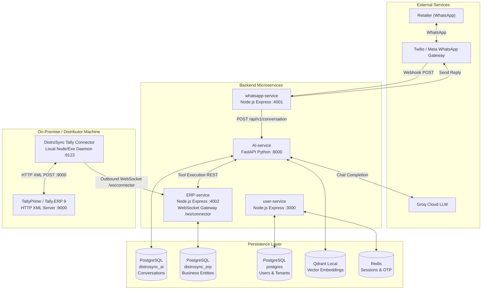

# System architecture

## High-Level Architecture

## Service Responsibilities

| Service | Language / Framework | Port | Responsibility |
|---------|---------------------|------|----------------|
| **whatsapp-service** | Node.js / Express | :4001 | Twilio webhook ingestion, signature verification, payload normalization to CanonicalEvent ([[canonical-event-model]]), outbound messaging |
| **AI-service** | Python / FastAPI | :8000 | Conversation orchestration, Groq LLM multi-turn tool calling ([[tool-calling-over-direct-db]]), conversation memory ([[persistent-conversation-memory]]), RAG hybrid search ([[rag-hybrid-search]]) |
| **ERP-service** | Node.js / Express | :4002 | Tenant-scoped CRUD for Customers, Products, Inventory, Orders, Documents; WebSocket connector gateway (`/ws/connector`) for on-premise ERP agents ([[erp-plugin-architecture]]) |
| **user-service** | Node.js / Express | :3000 | OTP signup, JWT cookie auth, Redis session storage, Company/WhatsApp/ERP configuration management |
| **connector** | Node.js / Pkg Standalone | :9123 | On-premise agent bridging TallyPrime XML HTTP server (:9000) with ERP-service via outbound WebSocket ([[tally-connector-websocket-bridge]]) |

## Key Architectural Tenets

1. **Zero ERP Coupling in AI Core** ??? The LLM operates against normalized domain tools (`search_products`, `get_inventory`, `create_order`). It never generates ERP-specific XML, SQL, or vendor API calls ([[tool-calling-over-direct-db]]).
2. **Provider-Agnostic Messaging** ??? Inbound payloads are normalized into a CanonicalEvent model ([[canonical-event-model]]). Switching from Twilio Sandbox to Meta Cloud API requires only a new boundary adapter.
3. **Multi-Tenant Data Isolation** ??? Business entities are partitioned by `tenantId` (Company UUID), enforced through HTTP middleware, repository query boundaries, and LLM tool execution contexts ([[multi-tenant-data-model]]).
4. **NAT-Traversing On-Premise Connector** ??? Outbound WebSocket allows on-premise connectors behind NAT/firewalls to connect to DISTROSYNC cloud without requiring public IPs or firewall port-forwarding ([[tally-connector-websocket-bridge]]).
5. **Synchronous HTTP REST (Current Phase)** ??? Services communicate via direct HTTP ([[synchronous-http-service-mesh]]). Asynchronous message broker (RabbitMQ/Kafka) is planned for production scale.

## Database Isolation

Each service owns its own PostgreSQL database. There is no shared database ??? services communicate only through HTTP REST APIs:
- `distrosync_ai` ??? conversation history (AI-service)
- `distrosync_erp` ??? business entities (ERP-service)
- `postgres` ??? users, companies, config (user-service)
- `Redis` ??? auth sessions and OTP codes (user-service)
- `Qdrant local` ??? PDF/document vector embeddings (AI-service)
