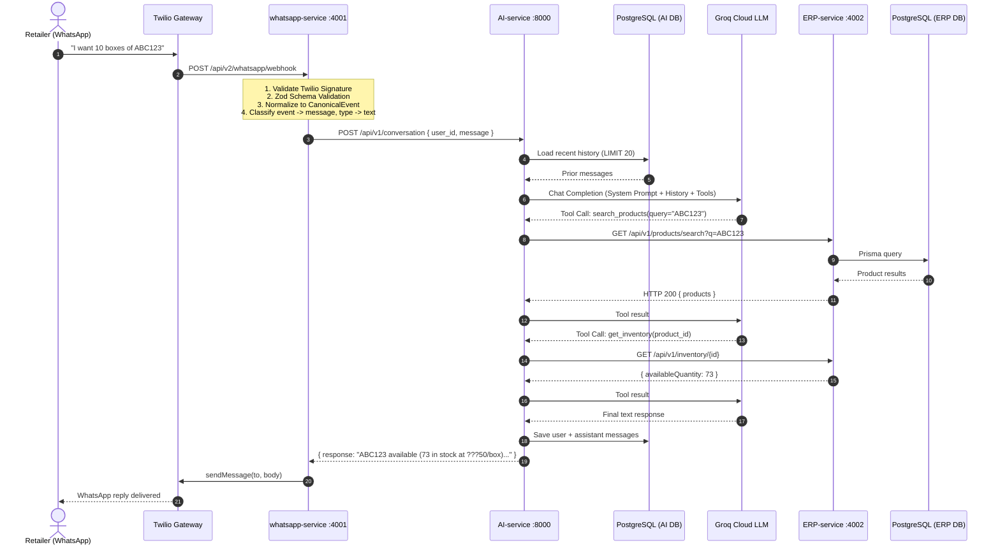
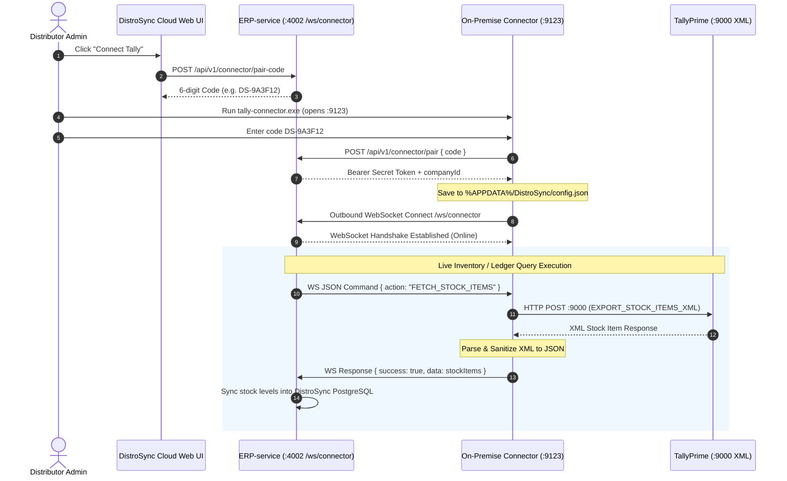

# Key flows

## End-to-End WhatsApp Order Flow

## Tally Connector Sync Flow (On-Premise WebSocket Bridge)

## WhatsApp Inbound Pipeline (Detail)

1. **Twilio Webhook** ??? `POST /api/v2/whatsapp/webhook` (URL-encoded body)
2. **Signature Verification** ??? `twilioSignatureMiddleware` validates `X-Twilio-Signature` using `TWILIO_AUTH_TOKEN`
3. **Payload Validation** ??? Zod schema checks required fields
4. **Canonical Normalization** ??? `twilio.adapter.js` maps Twilio form params -> `CanonicalEvent { type, from, body, timestamp }` ([[canonical-event-model]])
5. **Event Classification** ??? event type = message, message type = text
6. **Dispatch** ??? `textHandler` extracts text + WaId (phone number)
7. **AI Call** ??? `POST /api/v1/conversation { user_id: WaId, message: text }`
8. **Outbound** ??? `twilio.provider.js`: `sendMessage()` via Twilio SDK

## AI Orchestrator Loop

The `ConversationOrchestrator` runs up to **6 iterations** of:
1. Load conversation history from PostgreSQL (last 20 messages per `user_id`) ([[persistent-conversation-memory]])
2. Send system prompt + history + user message + 9 tool schemas to Groq
3. If LLM returns tool calls -> execute via `ToolExecutor` against ERP-service REST APIs ([[tool-calling-over-direct-db]])
4. Feed tool results back to LLM
5. Repeat until LLM returns a final text response
6. Persist user message + assistant response to memory

## Tool Execution

9 registered tools, all executing against ERP-service REST APIs with `x-service-key` + `x-tenant-id` headers:
- `search_products`, `get_product_details` ??? catalog lookup
- `get_inventory` ??? stock availability check
- `get_customer`, `get_customer_orders` ??? customer identity & history
- `create_order`, `get_order_status` ??? order lifecycle
- `search_knowledge_base` ??? RAG hybrid search against uploaded PDFs ([[rag-hybrid-search]])
- **Idempotency**: SHA-256 cache prevents duplicate side-effects (e.g., double order creation)
