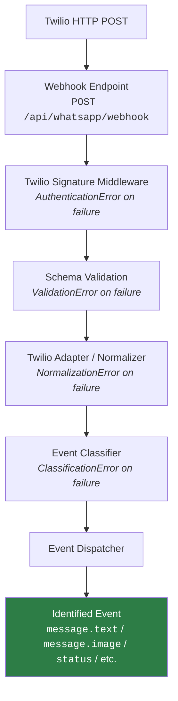

# WhatsApp Inbound Pipeline — Event Identification System

## 1. Architecture Design

The pipeline transforms a raw Twilio webhook into a clean, validated, normalized, canonical event with a clearly identified event type. Nothing more.



### Stage Responsibilities

| # | Stage | Responsibility | Input | Output | Failure |
|---|-------|---------------|-------|--------|---------|
| 1 | **Webhook Endpoint** | HTTP routing. Applies `urlencoded` body parsing. | Raw HTTP POST | Parsed `req.body` | 404/405 |
| 2 | **Signature Middleware** | Authenticates the request is genuinely from Twilio using HMAC-SHA1 of `X-Twilio-Signature`. Rejects forgeries before any processing. | `req.headers`, `req.body` | Verified request (pass-through) | `401` missing / `403` invalid |
| 3 | **Schema Validation** | Validates the structural shape of the Twilio payload — required fields by message type (text/media/status). Uses Zod. | `req.body` (Twilio form-data) | Validated payload object | `400` with structured errors |
| 4 | **Twilio Adapter / Normalizer** | Converts Twilio-specific field names into a provider-independent canonical structure. Normalizes phone numbers, timestamps, media metadata. Preserves raw provider data in `metadata.raw`. | Validated Twilio payload | Canonical event candidate | `NormalizationError` → 500 |
| 5 | **Event Classifier** | Determines `eventType` (message / interactive / status / unknown) and `messageType` (text / image / audio / etc.) using a registry pattern. | Canonical candidate | Classified canonical event | Falls back to `unknown` |
| 6 | **Event Dispatcher** | Resolves the final dot-notation event identifier (e.g. `message.text`, `status`). This is the **terminal point** of this implementation. | Classified event | `{ event: "message.text", canonicalEvent: {...} }` | Falls back to `unknown` |

### What Happens After Dispatch (NOT IMPLEMENTED)

The dispatcher returns the identified event. In a future phase, this is where:
- Handler registry would route `message.text` → TextHandler
- AI/LLM/RAG would process business intent
- ERP integration would occur
- Outbound responses would be generated

**None of that is built here.**

---

## 2. Twilio Signature Validation

### How Twilio Signature Verification Works

Twilio signs every webhook with HMAC-SHA1:
1. Twilio takes your **Auth Token** as the HMAC key
2. It constructs the signing input: **full webhook URL** + all POST body params sorted alphabetically and concatenated
3. It computes HMAC-SHA1, base64-encodes it, sends it as `X-Twilio-Signature`

### URL Construction Concern

The URL used for signature verification **must match exactly** what Twilio used when signing. In production behind a reverse proxy (nginx, ALB, Cloudflare), `req.protocol` will show `http` instead of `https` because TLS was terminated upstream. The middleware handles this by:

1. Checking `X-Forwarded-Proto` header first
2. Falling back to `req.protocol`
3. Using the `TWILIO_WEBHOOK_URL` env var as an override when set (recommended for production)

### Implementation

- File: [`src/whatsapp/middleware/twilioSignature.middleware.js`](file:///c:/Users/DELL/Desktop/DISTROSYNC/whatsapp-service/src/whatsapp/middleware/twilioSignature.middleware.js)
- Uses `twilio.validateRequest()` from the existing `twilio` package (already in `package.json`)
- Auth token from `process.env.TWILIO_AUTH_TOKEN` (never hardcoded)
- Throws `AuthenticationError` for missing/invalid signatures
- Returns HTTP 401 (missing) or 403 (invalid) with safe error messages

---

## 3. Request Validation Strategy

### Why Zod

The project **already has Zod v4** in `package.json` (`"zod": "^4.4.3"`). No new dependency needed. Zod is:
- TypeScript-first with excellent JS support
- Declarative — schemas are composable objects, not imperative checks
- Produces structured error objects automatically
- Much simpler than Joi for this use case (no `.alternatives()` ceremony)

### Validation Schemas

Three discriminated schemas based on what Twilio sends:

| Webhook Type | Required Fields | Optional |
|-------------|----------------|----------|
| **Text Message** | `MessageSid`, `AccountSid`, `From`, `To`, `Body` (non-empty) | `ProfileName`, `WaId` |
| **Media Message** | `MessageSid`, `AccountSid`, `From`, `To`, `NumMedia` ≥ 1, `MediaContentType0`, `MediaUrl0` | `Body` (caption, may be empty) |
| **Status Callback** | `MessageSid`, `AccountSid`, `MessageStatus` | `From`, `To`, `ChannelPrefix` |

The validator auto-detects which schema to apply based on the presence of `MessageStatus` (→ status) or `NumMedia > 0` (→ media) or default (→ text/general message).

### Structured Error Output

```js
{
  valid: false,
  errors: [
    { field: "From", code: "MISSING_FIELD", message: "Sender phone number is required" },
    { field: "Body", code: "EMPTY_FIELD", message: "Message body is required for text messages" }
  ]
}
```

---

## 4. Normalization Strategy

The normalizer transforms Twilio-specific fields into a provider-independent structure.

### Normalizations Applied

| Data | Twilio Format | Normalized Format |
|------|--------------|-------------------|
| Phone numbers | `whatsapp:+919876543210` | `+919876543210` (E.164, stripped `whatsapp:` prefix) |
| Timestamp | Not provided by Twilio webhook (only in API responses) | `new Date().toISOString()` — reception time in ISO-8601 |
| Message text | `Body` with possible whitespace | Trimmed, preserving meaningful content |
| Media | `MediaUrl0`, `MediaContentType0`, `NumMedia` | Array of `{ url, contentType, index }` objects |
| IDs | `MessageSid` | `id` field |
| Provider info | Implicit | `provider: "twilio"`, `channel: "whatsapp"` |

### Raw Metadata Preserved

The original `req.body` is preserved in `metadata.raw` so no Twilio-specific data is lost for debugging.

---

## 5. Provider Adapter Boundary

```
Twilio Payload ──→ twilio.adapter.js ──→ Canonical Event
Meta Payload   ──→ meta.adapter.js   ──→ Canonical Event  (FUTURE, NOT BUILT)
```

The adapter is a function: `normalize(validatedPayload) → CanonicalEvent`

Everything downstream of the adapter consumes only the canonical event. The controller, classifier, and dispatcher have **zero knowledge** of Twilio field names.

---

## 6. Canonical Event Schema

```js
{
  id: "SM1234...",              // Provider message ID
  provider: "twilio",           // "twilio" | "meta" | ...
  channel: "whatsapp",          // "whatsapp" | "sms" | ...
  eventType: "message",         // "message" | "interactive" | "status" | "unknown"
  messageType: "text",          // "text" | "image" | "audio" | "video" | "document" | "location" | "contact" | "interactive" | "sticker" | "unknown" | null
  sender: {
    phone: "+919876543210",     // E.164
    name: "John",               // Profile name if available
    waId: "919876543210"        // WhatsApp ID if available
  },
  recipient: {
    phone: "+14155238886"       // E.164
  },
  timestamp: "2026-08-21T14:30:00.000Z",  // ISO-8601
  content: {
    text: "Hello world",        // For text messages
    media: [                    // For media messages
      { url: "https://...", contentType: "image/jpeg", index: 0 }
    ],
    caption: "Photo caption",   // Media caption
    latitude: null,             // For location
    longitude: null,
    status: null                // For status events: "sent" | "delivered" | "read" | "failed"
  },
  metadata: {
    accountSid: "AC...",
    apiVersion: "2010-04-01",
    numSegments: 1,
    raw: { /* original req.body */ }
  }
}
```

> [!IMPORTANT]
> `eventType` = what kind of webhook event (message vs status)
> `messageType` = what kind of content (text vs image vs audio)
> Business intent (order, inquiry, etc.) is **NOT** part of this schema.

---

## 7. Classification Strategy

### Event Type Classification

| Condition | eventType |
|-----------|-----------|
| Has `MessageStatus` field, no `Body`/`NumMedia` | `status` |
| Has `ButtonText` or `ListId` | `interactive` |
| Has `MessageSid` + (`Body` or `NumMedia`) | `message` |
| None of the above | `unknown` |

### Message Type Classification (Registry Pattern)

A `MESSAGE_TYPE_CLASSIFIERS` array of `{ type, test(normalizedData) }` objects, evaluated in priority order:

| Priority | Type | Detection Rule |
|----------|------|---------------|
| 1 | `image` | Media with contentType starting with `image/` (not `image/webp`) |
| 2 | `sticker` | Media with contentType `image/webp` |
| 3 | `video` | Media with contentType starting with `video/` |
| 4 | `audio` | Media with contentType starting with `audio/` |
| 5 | `document` | Media with contentType `application/*` or other non-media types |
| 6 | `location` | Has `Latitude` and `Longitude` in raw payload |
| 7 | `contact` | Has `vCard` data in raw payload |
| 8 | `interactive` | Has `ButtonText` or list selection data |
| 9 | `text` | Has non-empty text content |
| 10 | `unknown` | Default fallback |

This is extensible — adding a new type means pushing one object into the registry.

---

## 8. Dispatcher Strategy

The dispatcher maps `(eventType, messageType)` → a dot-notation event string.

```js
EVENT_REGISTRY = {
  "message.text":        { eventType: "message",     messageType: "text" },
  "message.image":       { eventType: "message",     messageType: "image" },
  "message.audio":       { eventType: "message",     messageType: "audio" },
  "message.video":       { eventType: "message",     messageType: "video" },
  "message.document":    { eventType: "message",     messageType: "document" },
  "message.location":    { eventType: "message",     messageType: "location" },
  "message.contact":     { eventType: "message",     messageType: "contact" },
  "message.sticker":     { eventType: "message",     messageType: "sticker" },
  "message.interactive": { eventType: "message",     messageType: "interactive" },
  "interactive.button":  { eventType: "interactive",  messageType: "button" },
  "interactive.list":    { eventType: "interactive",  messageType: "list" },
  "status":              { eventType: "status",       messageType: null },
  "unknown":             { eventType: "unknown",      messageType: null }
}
```

Dispatch logic: `eventType + "." + messageType` → lookup in registry → return event identifier.

The dispatcher does **NOT** invoke handlers. It returns:

```js
{
  event: "message.text",
  canonicalEvent: { /* full canonical event object */ }
}
```

---

## 9. Error Handling Strategy

Four dedicated error classes, all extending a base `WebhookError`:

| Error Class | HTTP Status | When |
|-------------|------------|------|
| `AuthenticationError` | 401 / 403 | Invalid/missing Twilio signature |
| `ValidationError` | 400 | Schema validation failure |
| `NormalizationError` | 500 | Data transformation failure |
| `ClassificationError` | 500 | Classification logic failure (should not happen — falls back to unknown) |

A centralized error-handling middleware catches all `WebhookError` subtypes and returns safe, structured JSON without stack traces or internal details.

---

## 10. Idempotency — Design Only

> [!NOTE]
> **Not implemented in this phase.** Documented for future reference.

Twilio may retry webhooks up to 14 times. The idempotency check should happen **after validation but before business processing**:

```
Signature ✓ → Validation ✓ → [IDEMPOTENCY CHECK HERE] → Normalization → Classification → Dispatch → Handlers
```

Implementation approach (future):
- Use Redis `SETNX` with `MessageSid` as key
- TTL of ~24 hours
- If key exists → return `200` immediately (tell Twilio we got it) but skip processing
- The check should be a middleware, not embedded in the classifier or dispatcher

A placeholder interface is defined in the adapter output but no Redis logic is wired.

---

## 11. Project Structure

> [!IMPORTANT]
> All new code goes under `src/whatsapp/` to keep the inbound pipeline self-contained and separate from the existing minimal code in `src/controllers/` and `src/services/`.

```
src/
├── app.js                                   [MODIFY] — mount new pipeline routes
├── whatsapp/
│   ├── routes/
│   │   └── webhook.routes.js                [NEW] — POST route with middleware chain
│   ├── controllers/
│   │   └── webhook.controller.js            [NEW] — thin orchestrator
│   ├── middleware/
│   │   ├── twilioSignature.middleware.js     [NEW] — HMAC signature validation
│   │   └── errorHandler.middleware.js        [NEW] — centralized error formatting
│   ├── validation/
│   │   ├── webhook.schema.js                [NEW] — Zod schemas
│   │   └── webhook.validator.js             [NEW] — validation runner
│   ├── adapters/
│   │   └── twilio.adapter.js                [NEW] — Twilio → canonical normalizer
│   ├── classification/
│   │   ├── event.classifier.js              [NEW] — eventType classifier
│   │   └── message.classifier.js            [NEW] — messageType classifier (registry)
│   ├── events/
│   │   ├── event.types.js                   [NEW] — constants & enums
│   │   ├── event.registry.js                [NEW] — event registry map
│   │   └── event.dispatcher.js              [NEW] — final dispatcher
│   ├── models/
│   │   └── canonical-event.js               [NEW] — canonical event factory
│   └── errors/
│       └── webhook.errors.js                [NEW] — error class hierarchy
```

### Files NOT Modified
- `src/controllers/webhook.controller.js` — existing controller left intact (handles the old simple echo flow)
- `src/services/` — untouched
- `src/middleware/twiliio.middleware.js` — existing middleware left intact
- `src/routes/webhook.router.js` — existing router left intact

The existing code continues to work at its current routes. The new pipeline is mounted at a **new route prefix** so both can coexist during transition.

---

## 12. Verification Plan

### Automated Tests

Testing framework: **Jest** (standard for Node.js, will add as devDependency).

```bash
npx jest --verbose
```

#### Test suites:

| Suite | File | Tests |
|-------|------|-------|
| Signature Middleware | `tests/middleware/twilioSignature.test.js` | Valid sig, invalid sig, missing sig, proxy URL handling |
| Validation | `tests/validation/webhook.validator.test.js` | Valid text, valid media, missing MessageSid, missing From, missing To, media without metadata, status event, empty body |
| Normalization | `tests/adapters/twilio.adapter.test.js` | Phone normalization, timestamp, text trimming, media extraction, metadata preservation |
| Classification | `tests/classification/classifier.test.js` | text, image, audio, video, document, location, contact, interactive, sticker, status, unknown |
| Dispatcher | `tests/events/dispatcher.test.js` | message.text, message.image, message.audio, message.video, message.document, message.location, message.contact, interactive.button, status, unknown |
| Integration | `tests/integration/pipeline.test.js` | Full end-to-end: raw Twilio payload → dispatch result for all 12 example scenarios |
| Errors | `tests/errors/webhook.errors.test.js` | Error class hierarchy, HTTP status codes, safe serialization |

### Manual Verification

- Demonstrate the pipeline with example payloads showing `RAW INPUT → DISPATCH RESULT` for all 12 scenarios listed in the requirements.

---

## Open Questions

> [!IMPORTANT]
> **Route mounting**: I plan to mount the new pipeline at `/api/v2/whatsapp/webhook` while leaving the existing `/api/whatsapp/webhook` untouched. Once you're satisfied with the new pipeline, you can switch over. Is this acceptable, or do you prefer I replace the existing routes in-place?

> [!NOTE]
> **Sticker detection**: Twilio sends stickers as `image/webp` media. The plan classifies `image/webp` → `sticker` and all other images → `image`. If you prefer stickers to be classified as `image`, let me know.
